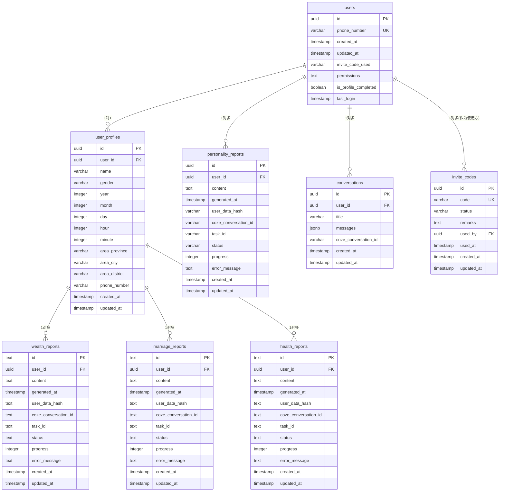
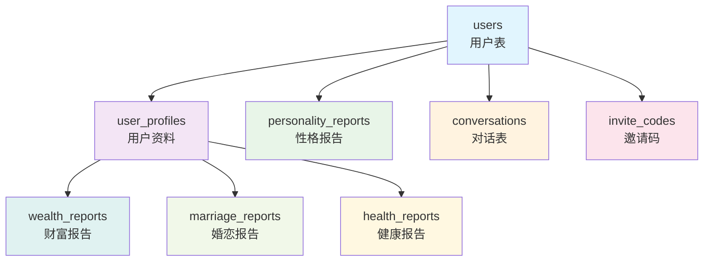

# 天乙神算项目 - 数据库关系图

## 数据库ER图 (Entity Relationship Diagram)



## 数据库关系分析

### 1. 核心架构：一主多从结构

```
users (主表)
├── user_profiles (1:1 关系)
├── personality_reports (1:N 关系)
├── conversations (1:N 关系)
└── invite_codes (1:N 关系，作为邀请码使用方)

user_profiles (扩展表)
├── wealth_reports (1:N 关系)
├── marriage_reports (1:N 关系)
└── health_reports (1:N 关系)
```

### 2. 表关系说明

| 表名 | 主键 | 外键关系 | 关系类型 | 说明 |
|------|------|----------|----------|------|
| users | id | - | 主表 | 用户核心信息，手机号登录 |
| user_profiles | id | user_id → users.id | 1:1 | 用户详细资料，生辰八字信息 |
| personality_reports | id | user_id → users.id | 1:N | 性格分析报告 |
| conversations | id | user_id → users.id | 1:N | 用户对话记录 |
| invite_codes | id | used_by → users.id | N:1 | 邀请码，使用者关联用户 |
| wealth_reports | id | user_id → user_profiles.id | N:1 | 事业财富报告 |
| marriage_reports | id | user_id → user_profiles.id | N:1 | 婚恋感情报告 |
| health_reports | id | user_id → user_profiles.id | N:1 | 身体健康报告 |

### 3. 业务逻辑分析

**用户流程：**
1. 用户通过手机号注册 → `users` 表
2. 完善个人信息 → `user_profiles` 表  
3. 生成各类报告 → `personality_reports`, `wealth_reports`, `marriage_reports`, `health_reports`
4. 进行对话交互 → `conversations` 表
5. 使用邀请码系统 → `invite_codes` 表

**报告系统架构：**
- 采用异步生成模式，支持任务队列
- 所有报告表结构一致，便于维护
- 支持进度跟踪和错误处理

### 4. 数据完整性设计

**级联删除策略：**
- 删除用户时，其资料和报告同步删除
- 保持数据一致性，避免孤立数据

**唯一性约束：**
- 手机号唯一（登录凭证）
- 每个用户只能有一条资料记录
- 每类报告每个用户只能有一条记录

### 5. 性能优化考虑

**索引策略：**
- 所有外键字段都建立了索引
- 支持快速关联查询
- 状态字段索引用于条件查询

**行级安全(RLS)：**
- 报告表启用RLS策略
- 用户只能访问自己的数据
- 保障数据安全和隐私

## 可视化关系图



这个数据库设计遵循了良好的关系数据库设计原则，具有清晰的层级结构和完整的数据完整性约束。