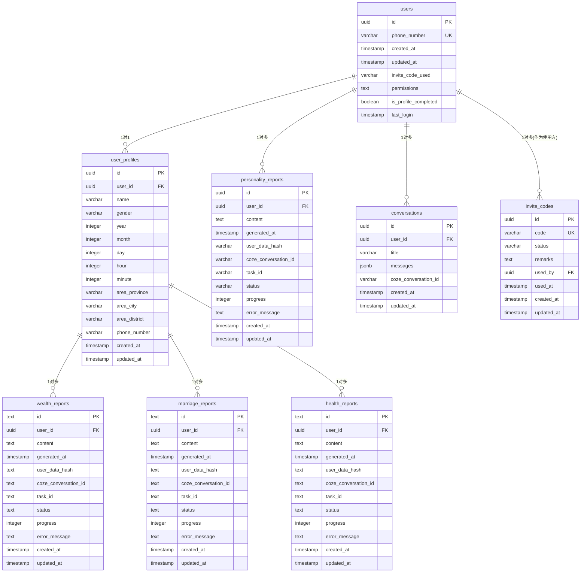
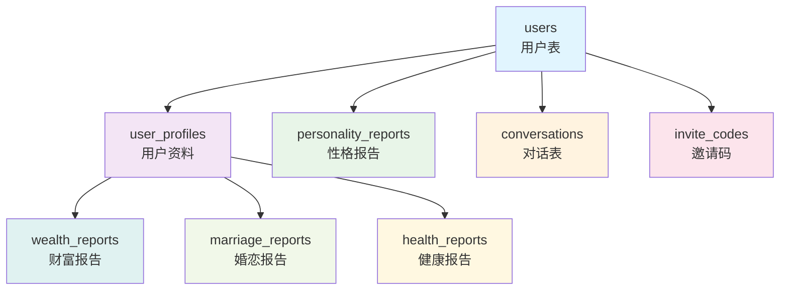

# Mermaid图表查看指南

## 图表1：标准ER图（表结构和字段关系）

使用以下Mermaid语法渲染：



## 图表2：流程关系图（业务逻辑数据流向）

使用以下Mermaid语法渲染：



## 推荐查看方式：

### 1. 在线Mermaid渲染器
- 访问 [Mermaid Live Editor](https://mermaid.live/)
- 复制上述mermaid代码片段到编辑器中即可查看

### 2. 支持Mermaid的Markdown编辑器
- **VSCode**: 安装 "Mermaid Preview" 插件
- **Typora**: 直接打开.md文件即可预览
- **Notion**: 支持Mermaid代码块

### 3. 浏览器插件
- 安装 "Mermaid Diagram" 相关浏览器插件
- 直接在浏览器中预览.md文件

### 4. 命令行工具
```bash
# 安装mermaid-cli
npm install -g @mermaid-js/mermaid-cli

# 渲染图表
mmdc -i input.md -o output.png
```

## 图表说明：

**图表1 (ER图)**：展示了数据库的标准化结构，包括：
- 每个表的字段定义
- 主键和外键关系
- 数据类型和约束

**图表2 (流程图)**：展示了业务数据的流向，包括：
- 数据表之间的层级关系
- 业务逻辑的数据流向
- 不同颜色代表不同类型的表

选择其中任何一种方式都可以清晰地看到您的数据库关系可视化图表！